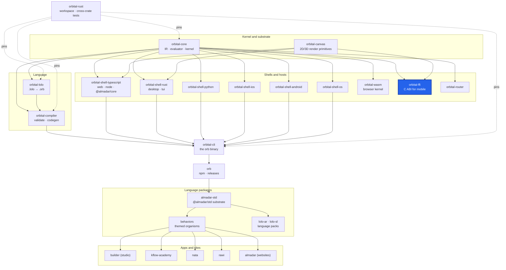

<div align="center">

# orbital-ffi

**The one native library both mobile shells link: the renderer C ABI, the kernel C ABI and the JNI forwarders.**

[](https://github.com/almadar-io/orbital-ffi/actions/workflows/ci.yml)
[](LICENSE)

</div>

`orbital-ffi` packages the embedded kernel and the canvas renderer behind a C ABI so iOS (SwiftUI) and Android (Jetpack Compose) hosts run the same kernel as every other host. It builds as `staticlib` (iOS), `cdylib` (Android) and `rlib`. It marshals; every decision is the kernel's.

## Where this fits



| Upstream (this repo depends on) | Downstream (depends on this repo) |
|---|---|
| [orbital-core](https://github.com/almadar-io/orbital-core): the embedded kernel | [orbital-shell-ios](https://github.com/almadar-io/orbital-shell-ios): links the static library |
| [orbital-canvas](https://github.com/almadar-io/orbital-canvas): the renderer, built with its `http` feature | [orbital-shell-android](https://github.com/almadar-io/orbital-shell-android): links the shared library through JNI |

## Quick start

The crate reads the Almadar language data from installed npm packages, so install those first. The toolchain is pinned to Rust 1.93.0 in `rust-toolchain.toml`.

```bash
npm install --no-save --no-package-lock @almadar/core@^10 @almadar/std@^16 @almadar/lolo-ar@^1 @almadar/lolo-sl@^1
cargo test
```

## What's inside

| Path | Purpose |
|---|---|
| `src/kernel_c_api.rs` | The kernel C ABI (over `orbital_core::embed`) |
| `src/lib.rs` | Re-exports `orbital_canvas::c_api`, the renderer C ABI |
| `src/jni_bridge.rs`, `src/jni_kernel_bridge.rs`, `src/jni_util.rs` | JNI forwarders for Android (string and array marshalling) |
| `tests/` | Fixtures, including resolved schemas the kernel tests boot from |
| `benches/c_abi_fixtures.rs` | C ABI benchmark |

The device libraries are built from the orbital-rust workspace with `make ios-lib` and `make android-lib`; see the workspace `Makefile`.

## Development

- Test with `cargo test`; CI (`.github/workflows/ci.yml`) runs it on push and pull request to `main`.
- Open gaps are tracked in [`Almadar_Gaps.md`](Almadar_Gaps.md). Work on `main` only; there are no feature branches.
- Inside the monorepo this repo is the submodule `orbital-rust/crates/orbital-ffi`.

## Docs

- [Orbital Core](https://github.com/itechdom/kflow.ai/blob/main/docs/Almadar_Orbital_Core.md)
- [Orbital Shell iOS](https://github.com/itechdom/kflow.ai/blob/main/docs/Almadar_Orbital_Shell_iOS.md) and [Orbital Shell Android](https://github.com/itechdom/kflow.ai/blob/main/docs/Almadar_Orbital_Shell_Android.md)
- [Execution Semantics](https://github.com/itechdom/kflow.ai/blob/main/docs/Almadar_Execution_Semantics.md)

## License

[Business Source License 1.1](LICENSE): free for non-commercial use and internal evaluation; commercial production use needs a licence from Almadar FZE. Converts to Apache-2.0 on 2030-02-01.
